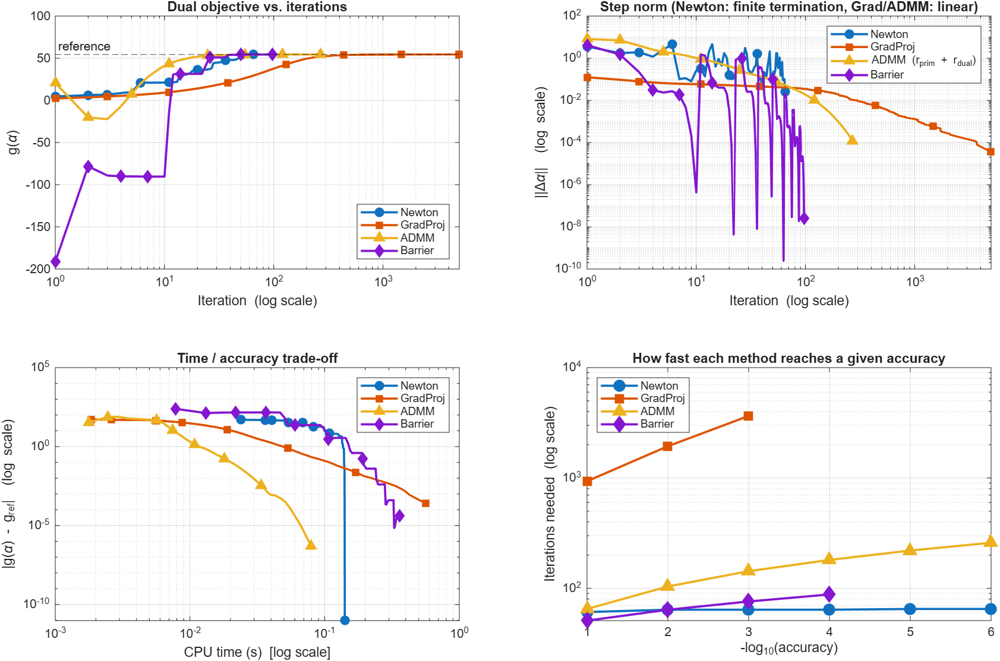
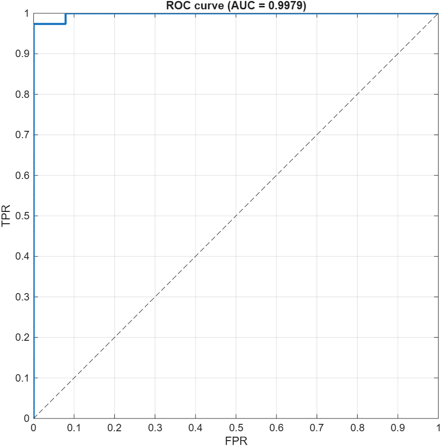
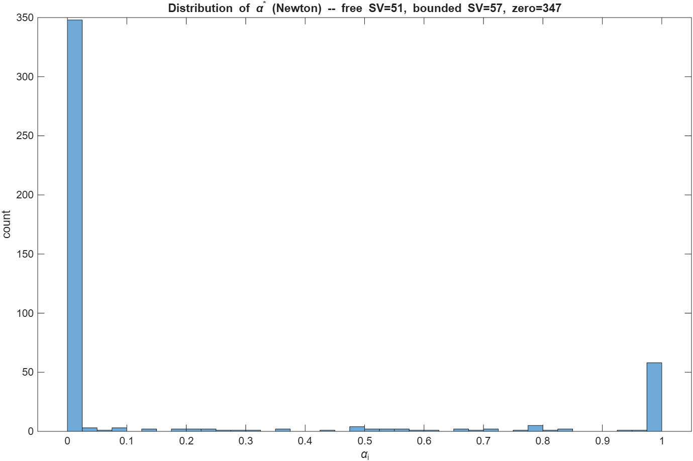

# Dual SVM via Constrained Optimization

Four constrained-optimization algorithms, implemented from scratch in MATLAB, for training a kernel (RBF) Support Vector Machine on the [Breast Cancer Wisconsin (Diagnostic)](https://archive.ics.uci.edu/dataset/17/breast+cancer+wisconsin+diagnostic) dataset. Each algorithm is checked against MATLAB's `quadprog` and `fmincon`, and optionally against CVX.

Built as a university project for the *Constrained Optimization* course. The full technical write-up (derivations, function reference, how to read the plots, verified results) is in **[Documentation.md](Documentation.md)**.

## The problem

Training a soft-margin SVM amounts to solving the dual QP

$$
\min_{\alpha}\; f(\alpha) = \tfrac12\,\alpha^\top Q\,\alpha - \mathbf 1^\top \alpha
\quad\text{s.t.}\quad y^\top \alpha = 0,\qquad 0 \le \alpha_i \le C,
$$

where $Q_{ij} = y_i y_j\,K(x_i, x_j)$ and $K(x, x') = \exp(-\gamma\lVert x - x'\rVert^2)$.
$Q$ is constant and positive semidefinite. The feasible set is a box intersected with a hyperplane.

## Algorithms

| File | Method | Idea |
|---|---|---|
| `svm_newton.m` | **Projected Newton** (ε-active set, Bertsekas) | Fixes variables near an active bound, takes a reduced Newton step on the free ones, and searches along the projected arc. Terminates once the active face is identified. |
| `svm_gradient_proj.m` | **Projected gradient** | $\alpha \leftarrow \Pi_F(\alpha + t(\mathbf 1 - Q\alpha))$ with fixed step $t = 1/\lambda_{\max}(Q)$. |
| `svm_admm.m` | **ADMM** | Splits the problem into objective ($\alpha$) and constraints ($z$). $Q + \rho I$ is Cholesky-factorized once, and the $z$-step is a projection. |
| `svm_barrier.m` | **Interior point (log barrier)** | Newton on $f - \mu\sum(\log\alpha_i + \log(C - \alpha_i))$ with $y^\top\alpha = 0$, decreasing $\mu$ until the duality gap $2n\mu < \text{tol}$. |

Shared building blocks:

- `project_feasible.m` computes the **exact** Euclidean projection onto $\{y^\top\alpha = 0,\ 0 \le \alpha \le C\}$. The solution is $\text{clip}(v - \lambda y, 0, C)$, and the scalar $\lambda$ is found by bisection followed by a closed-form refinement.
- `rbf_kernel.m` builds $K$ and $Q$.
- `predict_svm.m` computes the decision function. The bias $b$ is averaged over the free support vectors.
- `evaluate_metrics.m` computes accuracy, F1 and ROC AUC. The AUC uses the Mann–Whitney statistic and handles tied scores.
- `plot_convergence.m` draws the convergence plots.
- `svm_cvx.m` is an optional CVX reference solution.

## Running

```matlab
>> main
```

Run it from this folder. The script loads and normalizes the data, builds $Q$, solves the problem with the reference solvers and the four algorithms, and prints the comparison tables. It saves the figures to `results/`.

**Requirements:**

- MATLAB R2020a or newer, with the **Optimization Toolbox** (`quadprog`, `fmincon`).
- [CVX](http://cvxr.com) is optional. If it isn't installed, that step is skipped.

If `wdbc.data` is missing, the script falls back to synthetic data (two Gaussian blobs in 30-D).

## Results

Setup: 455 training and 114 test samples (random 80/20 split, z-scored), $C = 1$, $\gamma = 1/p = 1/30$, tolerance $10^{-4}$.

| Algorithm | Dual objective | $\lVert\alpha - \alpha_{qp}\rVert$ | Iterations |
|---|---|---|---|
| quadprog (reference) | 54.399950 | — | — |
| fmincon | 54.399944 | 2.4e-05 | — |
| **Newton** | 54.399950 | **9.4e-09** | **65** |
| Projected gradient | 54.399702 | 8.8e-02 | 5000 (cap) |
| ADMM | 54.399950 | 7.3e-04 | 270 |
| Barrier | 54.399910 | 1.3e-04 | 97 |

All four reach the same test performance as `quadprog`: **accuracy 0.9912, F1 0.9867, ROC AUC 0.9979**.



| ROC curve | Distribution of α* |
|---|---|
|  |  |

**Notes:**

- **Projected gradient** converges linearly, at a rate set by the condition number of $Q$ (about $3\cdot10^5$ here). It does not reach a projected-gradient norm of $10^{-4}$ within 5000 iterations, but its classifier is already identical to the others.
- **Newton** becomes exact once the active face is identified. For very small $\gamma$ combined with large $C$, $Q$ is nearly singular and identifying the face can take far longer. Barrier is the most robust method in that regime.
- Run times depend on the machine. ADMM is usually the fastest of the four.

## Dataset

`wdbc.data` is the *Breast Cancer Wisconsin (Diagnostic)* dataset by W. Wolberg, O. Mangasarian, N. Street and W. Street. It comes from the UCI Machine Learning Repository ([doi:10.24432/C5DW2B](https://doi.org/10.24432/C5DW2B)) and is licensed under CC BY 4.0. It has 569 samples, 30 features, and binary labels (malignant / benign).
